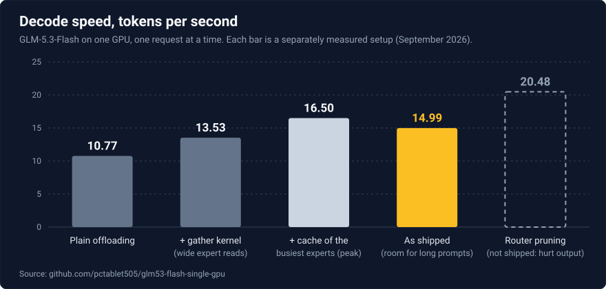

**I make machine-learning models smaller and faster, so they fit and run well on hardware smaller than they were built for. Then I measure what each change actually bought.**

**GLM-5.3-Flash: a model nearly twice the size of the GPU's memory, from 10.8 to 16.5 tokens a second.** Most of its weights sit in 288 experts per layer, and each token uses only 8, so most of the model can live in system memory. Plain offloading then waits on expert reads.

- **A gather kernel** I wrote, which reads experts in wide blocks: 13.5 tokens a second.
- **A cache of the busiest experts.** 35% of them get 74% of the router's picks, so I moved more of the model off the GPU and spent the freed memory on those: 16.5 at peak, 15.0 in the shipped setup, which leaves room for long prompts.
- **Grouped staging for long prompts:** prompt reading went from 614 to about 1,750 tokens a second.

One of the eight bugs on the way gave no error at all. **[How it works, and that bug →](https://github.com/pctablet505/glm53-flash-single-gpu)**

**Open source: [100 merged pull requests in 38 projects](https://github.com/search?q=is%3Apr+author%3Apctablet505+is%3Amerged+-user%3Apctablet505&type=pullrequests) I don't maintain** (counted 26 October 2026). Most are in Keras and KerasHub, where I built the export path from a trained model to a LiteRT file a phone can run. Others are fixes in pip, pydantic and pyright.

**Earlier, on phones, all closed source:**
- models made 3x faster on a phone's NPU and DSP, and quantization-aware training that cut memory bandwidth by 75%;
- a damaged-barcode reader taken from 70% to 90% accuracy with over 10 million synthetic images;
- a phone-drop detector cut from millions of parameters to under 20, at 95% less power.

**Side projects:** [Porchlamp](https://porchlamp.org/) ranks open-source projects by what happens to a stranger's pull request. [RL Alpha Labs](https://rlalphalabs.com/) tests trading ideas after real costs and tax.

Open to roles in ML performance and on-device AI. Job history and contact: **[pctablet505.github.io](https://pctablet505.github.io/)**
