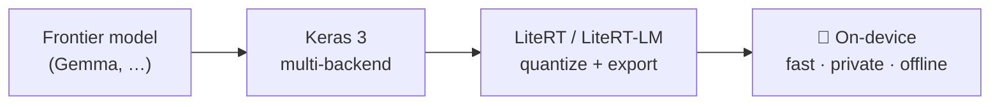

# Hi, I'm Rahul 👋

**ML engineer and open-source contributor to Keras** — I enjoy making machines a little
smarter every day, and making the smart ones run fast on small devices.
Previously at Qualcomm and Samsung R&D, building **face recognition, computer
vision, and sensor-driven systems** for millions of devices. Based in India 🇮🇳.

🌐 **[pctablet505.github.io](https://pctablet505.github.io)** · 💼 [LinkedIn](https://www.linkedin.com/in/pctablet505/) · 📈 1,000+ contributions in the last year

---

## ⚡ Open-source impact

**100+ merged pull requests** in 70+ open-source projects, **60+ of them in the Keras ecosystem**
([keras](https://github.com/keras-team/keras/pulls?q=is%3Apr+author%3Apctablet505+is%3Amerged) ·
[keras-hub](https://github.com/keras-team/keras-hub/pulls?q=is%3Apr+author%3Apctablet505+is%3Amerged)).
GitHub keeps the live count: [all merged pull requests →](https://github.com/search?q=is%3Apr+author%3Apctablet505+is%3Amerged+-user%3Apctablet505&type=pullrequests)

Merged work I'm proud of:

- [keras#22758](https://github.com/keras-team/keras/pull/22758) — **LiteRT export for the PyTorch backend**: on-device deployment of PyTorch-trained Keras 3 models
- [keras-hub#2132](https://github.com/keras-team/keras-hub/pull/2132) — **Llama 3.1 implemented in KerasHub**
- [keras#22362](https://github.com/keras-team/keras/pull/22362) — **serialization fix**: custom models with sublayers in nested lists failed to save/load
- [keras#22998](https://github.com/keras-team/keras/pull/22998) — **torch-backend `SymInt` handling** in `convert_to_tensor` and `slice`

In review right now: 40+ pull requests, including vLLM, Keras and keras.io —
[open pull requests →](https://github.com/search?q=is%3Apr+author%3Apctablet505+is%3Aopen+-user%3Apctablet505&type=pullrequests)

---

## 🛠 What I work on

Edge & on-device AI · model optimization (quantization, latency, memory) ·
multi-backend Keras internals · computer vision & applied ML that actually ships.

Outside of Keras, my main project is **[RL Alpha Labs](https://rlalphalabs.com/)** — a research-stage, JAX-native
lab for algorithmic trading on Indian equities: PPO/DQN agents tested across **746 NSE
instruments** on 3.5+ years of market data, **128 vectorized environments**
for parallel rollout, and full portfolio simulation with risk controls; no live capital is deployed.
The code is private; the research, field notes and benchmarks are at **[rlalphalabs.com →](https://rlalphalabs.com/)**

> 🕶 **The part you can't see here:** my earlier work was
> **face recognition and face-related solutions** — plus computer-vision and
> camera/sensor problems — at Samsung R&D and Qualcomm. Real-time face auth
> serving 10,000+ registered faces on-device, embedding search cut from
> 1,200 ms → 87 ms, sensor-based drop detection at 95% less power. All
> closed-source, so GitHub only shows my Keras side.

---

## 🚀 Featured work

| Project | What it is |
|---|---|
| [Porchlamp](https://porchlamp.org/) 🏮 | **Find the projects that leave the light on** — 11,000 open-source projects ranked by what happens to a stranger's pull request, not by stars · [latest report](https://porchlamp.org/black-holes/) · [live ranking](https://porchlamp.org/) · [repo](https://github.com/pctablet505/porchlamp) |
| [RL Alpha Labs](https://rlalphalabs.com/) 🔒 | Research-stage, JAX-native RL trading research on Indian equities — PPO/DQN over 746 NSE instruments, 128 vectorized envs, portfolio simulation with risk controls · private code, [research and notes](https://rlalphalabs.com/research/) |
| [Servedeck](https://github.com/pctablet505/servedeck) | A systemd control plane, an OpenAI-compatible `/v1` gateway and a live dashboard for native vLLM on one Linux GPU workstation · [docs](https://pctablet505.github.io/servedeck/) |
| [GLM-5.3 on one GPU](https://github.com/pctablet505/glm53-flash-single-gpu) | GLM-5.3-Flash (320B total, 18B active, NVFP4) on one RTX PRO 6000 Blackwell — the best result we know of on a single RTX PRO 6000, with the full method |
| [flakehound](https://github.com/pctablet505/flakehound) | Hunt flaky tests before they bite: static flaky-pattern detection and run-history scoring for pytest, ML-testing aware (JAX, PyTorch, NumPy) |
| ats-optimizer 🔒 | Truthful, human-in-the-loop job-application automation — feed-based discovery, knowledge vault, tailored resumes, ATS analysis · private repo |
| [litert-demo](https://github.com/pctablet505/litert-demo) | End-to-end export of KerasHub Gemma3 → LiteRT `.tflite` / LiteRT-LM `.litertlm` |
| [gemma-tflite-android-demo](https://github.com/pctablet505/gemma-tflite-android-demo) | Gemma running fully on-device on Android |
| [jax-windows-cuda-build](https://github.com/pctablet505/jax-windows-cuda-build) | CUDA build scripts, patches & pre-built JAX wheels for Windows |
| [daily_tracker](https://github.com/pctablet505/daily_tracker) | Cross-platform daily task tracker with Google Drive sync & auto-updates |
| [ML-Guide](https://github.com/pctablet505/ML-Guide) | Curated AI/ML learning path — courses, books, study notes |

---

## 📊 GitHub at a glance

<!-- Static self-generated cards (see gen_cards.py) — the shared
     github-readme-stats instance rate-limits and breaks randomly. -->

---

## 📚 Currently exploring

- Better performance from smaller models — quantization, distillation, smarter kernels
- Synthetic data generation techniques
- Building a gallery search system
